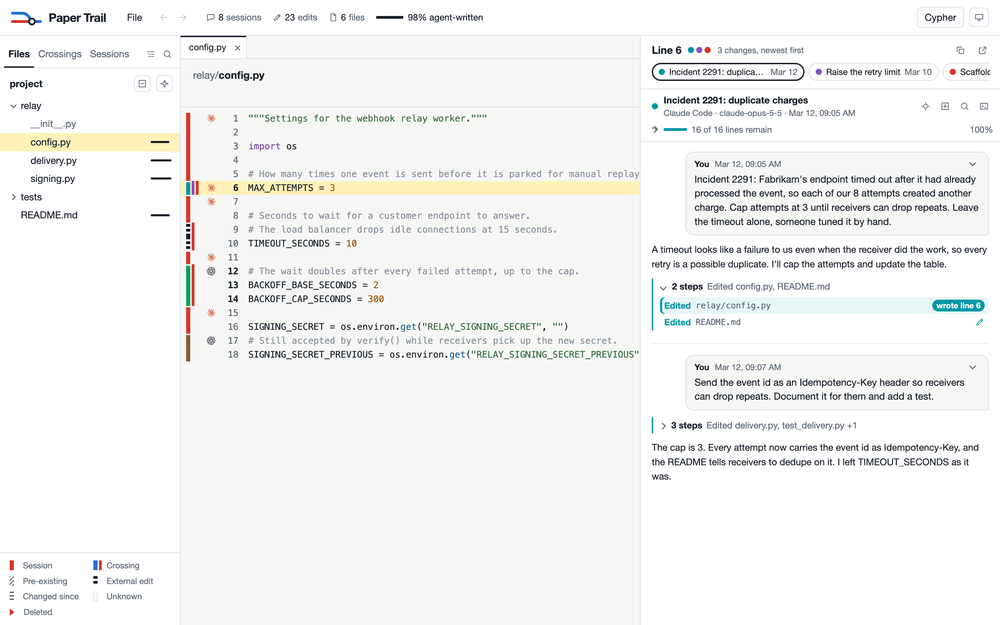

# Paper Trail

Point at a line of code and find the agent that wrote it, the instruction it was following, and the conversation you can resume. Paper Trail builds this history from the Claude Code and Codex CLI transcripts already on your disk. It runs locally with an embedded Relate database. It needs no hook, server, model or API key.



## The problem

Coding agents now write a large share of everyday code, over many sessions. When you come back to change a line, you often don't know why it is the way it is. `git blame` names a commit and whoever committed it. The request that actually produced the line sits in an agent transcript on the same disk, and nothing connects the two.

- In Stack Overflow's 2026 Developer Survey (more than 30,000 respondents), 73% of the developers who use AI coding assistants or agents use them daily. Claude Code (66%) and GitHub Copilot (59%) are the most used. [Results](https://stackoverflow.blog/2026/10/06/the-results-of-the-2026-developer-survey-are-here/)
- In the 2025 survey, 66% of developers named "AI solutions that are almost right, but not quite" as a frustration, and 45% said debugging AI-generated code takes more time. [AI section](https://survey.stackoverflow.co/2025/ai)
- Reading code to understand it was already most of the job before agents. A field study of 78 professional developers over 3,148 working hours found that about 58% of their time went to program comprehension. [Xia et al., IEEE TSE 2018](https://xin-xia.github.io/publication/TSE17.pdf)

Paper Trail shortens one part of that work: finding out what a person asked for when a line was written, and what it replaced. It does not measure how much time that saves.

Recording this as code is written is being standardized: Cursor's [Agent Trace](https://github.com/cursor/agent-trace) is a draft format for attributing code to agents and conversations, and it covers edits made after an agent adopts it. Paper Trail works backwards from transcripts that already exist, so it also covers code written last month.

## What it does

- **Line history.** For any line: which session wrote it (Claude Code or Codex, model and reasoning effort), the instruction behind it, and every earlier version it replaced, across agents and sessions.
- **Resume the conversation.** Each answer includes the command that reopens that session, so you can ask the agent that wrote the code.
- **Follow a session.** See everything one session changed, in order, with its instructions. Subagent edits lead back to the instruction given to the parent.
- **Deleted code.** Spots where lines were removed are marked. Unfold them to see the removed text and who removed it.
- **Crossings.** Find the places several sessions kept rewriting, which are often where requirements changed.
- **Survival.** For each session, how much of what it wrote is still in the files, and what replaced the rest.
- **Search across code and conversations.** One search covers current lines, your past instructions and deleted lines.
- **A guard for agents.** A skill makes Claude Code or Codex look up a line's history before changing it, and say so when a new request contradicts an earlier one.
- **Proven or likely.** Every line gets an owner. When the logs show the change itself, the owner is proven. When an agent changed a file with a script and the logs don't show what it wrote, Paper Trail names the most likely session and labels the line as inferred. On this repository, written entirely by Claude Code and Codex, 40% of lines are proven and almost all the rest are inferred.

## Try it: why is the retry limit 3?

The repository includes a made-up project and the agent sessions that built it. `demo/project` is a small worker that delivers webhooks, and `demo/logs` holds seven sessions over three weeks: four in Claude Code (one with a subagent) and three in Codex. With Python 3.11+ and [uv](https://docs.astral.sh/uv/) installed:

```sh
./start.sh demo
```

This opens the reader on `relay/config.py` line 6, `MAX_ATTEMPTS = 3`. The demo graph is committed, so nothing is built first.

The code does not say why the limit is 3. The line's history does:

1. The scaffold session (Claude Code) set it to 5.
2. A Codex session raised it to 8 after a customer's endpoint was down for 20 minutes and 312 events were parked.
3. A Claude Code session cut it to 3 two days later. Incident 2291: an endpoint timed out after it had already processed the event, so each of the 8 attempts created another charge. The instruction was to cap attempts at 3 "until receivers can drop repeats".

**Follow session** on the last one shows what it did next: it added an `Idempotency-Key` header in `relay/delivery.py`, a test, and a note for receivers in the README. Anyone who wants 8 again now knows what to check first.

Other things to look at in the demo:

- `backoff_delay` in `relay/delivery.py` was written by Claude Code, rewritten by Codex and rewritten again by Claude Code.
- `relay/delivery.py` has a red triangle where a Codex session deleted the legacy `X-Signature` header.
- `tests/test_delivery.py` was written by a subagent. Its lines lead back to the instruction the person gave the parent session.
- `relay/config.py` lines 9 and 10 were changed by hand between two sessions. Paper Trail marks them as a likely owner, not a proven one, and shows how a best guess can point to the wrong writer.
- The last line of `README.md` was added on disk after the final session.

## Use it on your own project

### 1. Build the history

From the Paper Trail checkout:

```sh
./start.sh /absolute/path/to/project
```

Paper Trail reads Claude Code (`~/.claude/projects`) and Codex (`~/.codex/sessions`) logs and saves the project's history to `.papertrail/graph.rl`. The reader shows history as soon as the first pass is ready, and the status bar shows progress while the rest of the logs are read in the background. Run `./start.sh -r /absolute/path/to/project` after new sessions to rebuild the graph. Later builds reuse a private local parse cache in `~/.cache/papertrail`.

To build without opening the reader:

```sh
uv run papertrail ingest --project /absolute/path/to/project
```

Use `--claude-logs DIR` or `--codex-logs DIR` when your logs are somewhere else. [Ingest details](docs/how-it-works.md#ingest-details)

### 2. Read it in the browser

```sh
uv run papertrail ui --project /absolute/path/to/project
```

The reader opens at `http://127.0.0.1:8765/` and works like a small code editor.

- **Lines.** Each session is a coloured track beside the line numbers; where tracks run side by side, those sessions all rewrote that spot. Click a line to see its route back through every change, with the instruction behind each one. A lighter track labelled "Likely …" is an inferred owner.
- **Follow session** dims every line the session did not touch and lists its instructions and edits in order. The arrows beside its name step through the places it wrote in the open file.
- **Deletions.** A small red triangle between two lines marks removed lines. Click it to unfold the removed text and see who deleted it. **Deleted** beside the file name unfolds every spot in the file.
- **Open a folder.** **File > Open Folder…** (⌘O) or **Open Recent…** (Ctrl+R). A folder with no graph yet gets a **Build History** button.
- **Navigate.** **Open File…** (⌘P, `name:42` jumps to line 42), **Go to Line…** (Ctrl+G), Back and Forward (Ctrl+- and Ctrl+Shift+-). The Files tab greys files no agent edited.
- **Search.** ⇧⌘F searches current lines, your past instructions and deleted lines at once. ⌘F finds in the open file; with the history panel focused, it searches the conversation instead.
- **Names.** ⌘-click a name (Ctrl-click elsewhere) to list every use in the folder, with who wrote each line, and jump to its definition.
- **Outline.** Functions and classes of the open file, each with a dot for every session that owns lines in it. Click one for the whole function's history.
- **Sessions.** How much of what each session wrote is still in the files, and which changes replaced or deleted the rest.
- **Copy.** The copy button in any history copies the place, the writer, the instruction and the resume command as Markdown.
- **Cypher** shows the queries behind the current view.

Use `--port` to change the port and `--no-browser` to skip opening a tab.

### 3. Ask from the command line

Run these inside the project, or add `--store /path/to/project/.papertrail/graph.rl`:

| Command | Answers |
| --- | --- |
| `papertrail blame FILE [-L START,END]` | Who wrote each range of the file, with model, time, session and the instruction. |
| `papertrail trace FILE:LINE` | The line's whole history: each writer, the full instruction, the resume command and the other files that session changed. |
| `papertrail session ID` | One session's instructions and edits in order. A unique prefix of the ID works. |
| `papertrail crossings [FILE]` | Places where two or more sessions rewrote the same lines. |
| `papertrail stats` | Sessions and edits per agent, and how many lines have a proven or likely owner. |

With uv, prefix them with `uv run` from the checkout. Every command takes `--json`, `--limit N` and `--show-cypher`. Try them on the demo:

```sh
cd demo/project
uv run papertrail trace relay/config.py:6
uv run papertrail session b27e5f90
```

[Complete example output](docs/example-session.md)

### 4. Let your agent check before it edits

```sh
uv run papertrail skill --project /absolute/path/to/project
```

This installs a skill in `.claude/skills/papertrail/` in that project. Before Claude Code changes code it did not write, it runs `blame` and `trace` and treats the instruction behind a line as a constraint the person may still hold. Asked to raise `MAX_ATTEMPTS` back to 8 in the demo, Claude Code with the skill made no edit: it reported the three instructions behind the line, pointed out that the limit was cut after incident 2291 and nothing yet shows receivers drop repeats, asked which way to go, and offered the command that reopens the incident conversation.

| Option | Effect |
| --- | --- |
| `--agent codex` | Installs for Codex in `~/.codex/skills/papertrail/`. `--agent all` installs both. |
| `--global` | Installs the Claude Code skill in `~/.claude/skills/papertrail/` for every project. |
| `--store PATH` | Points the skill at a graph outside the project's `.papertrail/`. |
| `--print` | Prints the skill without writing it. |

Run the command again if you move the Paper Trail checkout. The agent only reads the graph, and the skill tells it to keep past prompts out of commits and comments.

### Privacy

The graph and parse cache contain private prompts, file paths and code excerpts and stay on your machine. The cache lives outside your repository. Ingest writes a `.gitignore` into a new `.papertrail` folder so the graph stays out of your repository. The only committed graph here is the demo's, which holds made-up sessions. Ingest prints only counts; queries show details from your conversations.

## How it uses Relate

- **Mode:** single file (`relate-db==1.1.0`, embedded in the Python process).
- **Why this mode:** one closed `.rl` file is the whole history of a project, so it sits in `.papertrail/` beside the code. The CLI, the reader and the agent skill all open the same file read-only. Ingest builds a private file next to it and swaps it in when complete, which fits Relate's one-writer-per-store rule. A real graph holds private prompts, and one file is easy to keep out of git. In-memory would mean replaying every transcript on each query; a directory store would spread those prompts over many JSON checkpoints.
- **What the graph models:** sessions, the instructions a person gave in them, the edits that followed, and the hunks of lines each edit wrote. A hunk points at the earlier hunks whose lines it overwrote (`REPLACED`), so following `REPLACED*0..` gives a line's whole history across agents and sessions. `SPAWNED` leads subagent edits back to the parent's instruction, and `NEXT` orders each session's prompts and edits.
- **Where the data lives:** [`demo/project/.papertrail/graph.rl`](demo/project/.papertrail/graph.rl) is the committed graph of the demo (8 sessions, 23 edits, 25 hunks, 239 relationships). For your own project the graph is `.papertrail/graph.rl` in that project, kept out of git.

[How it works](docs/how-it-works.md) has the full schema, the `trace` query, how to open the store with the `relate` package, what the transcripts can and cannot prove, and the test and audit commands.
